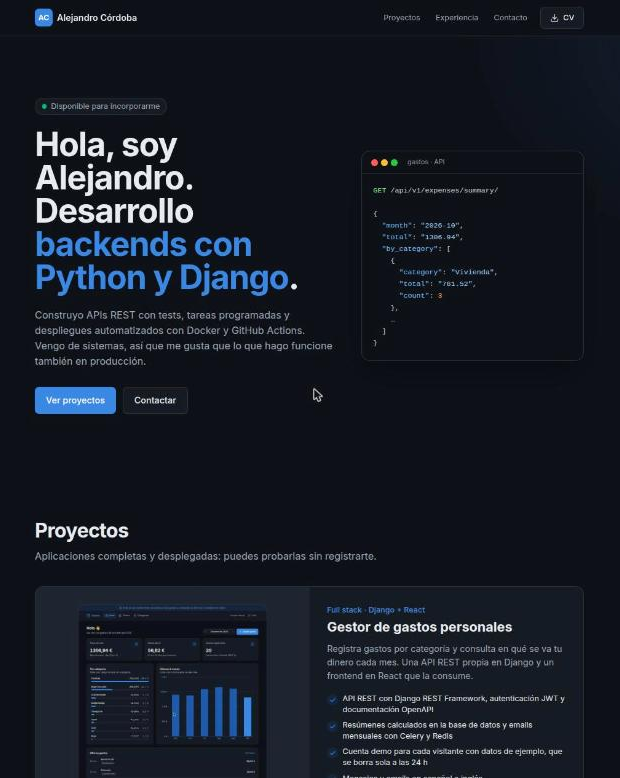

# Portfolio site

My personal landing page: who I am, my projects with live demos, experience and contact.
The content is in Spanish.



## Why plain HTML

A landing page is mostly text that should load instantly and be read by search engines and
link previews (LinkedIn, WhatsApp). So it is a single static `index.html` styled with
Tailwind CSS, built with Vite, with almost no JavaScript (only the copyright year). The
project demos themselves are separate apps, such as the
[expense tracker](https://github.com/SEDEBE/expense-tracker-web).

## Stack

HTML, Tailwind CSS 4, Vite, Docker (Nginx), GitHub Actions. Light and dark mode follow the OS.

## Run it

```bash
npm ci
npm run dev       # http://localhost:5174
npm run build     # static files in dist/
docker build -t portfolio-site . && docker run -p 8081:80 portfolio-site
```

Public URLs (site, demo, LinkedIn) live in `.env.production` and `.env.development`; Vite
writes them into `index.html` at build time. They are public values, not secrets.
